# JVM metric schema drift: detecting it before dashboards go blank

Upgrading the OpenTelemetry Java agent from 1.x to 2.x renames every JVM metric and most of
their labels. Nothing errors: CPU, heap and GC panels just stop drawing, and alerts built on
those metrics stop evaluating. This repo reproduces that upgrade on
[Spring PetClinic Microservices](https://github.com/spring-petclinic/spring-petclinic-microservices)
and detects the change three ways: in CI before the deploy, at runtime against a contract,
and at runtime with no contract at all.


## Architecture

Each PetClinic service runs with the OpenTelemetry Java agent attached (`-javaagent`). The agent
reads the JVM runtime (memory, GC, threads, CPU) and serves it in Prometheus format on `:9464`.
Prometheus scrapes it and evaluates the schema-drift rules; Grafana queries Prometheus.

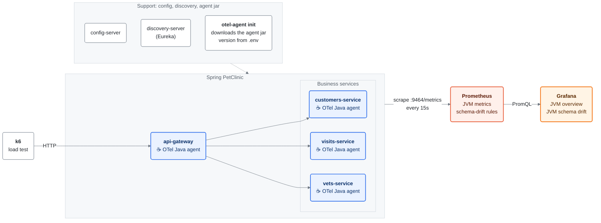

### From the agent to a Grafana panel

The upgrade changes only what the agent emits. Everything downstream (the scrape, the PromQL, the
panel) keeps asking for the old names, which is why nothing errors.

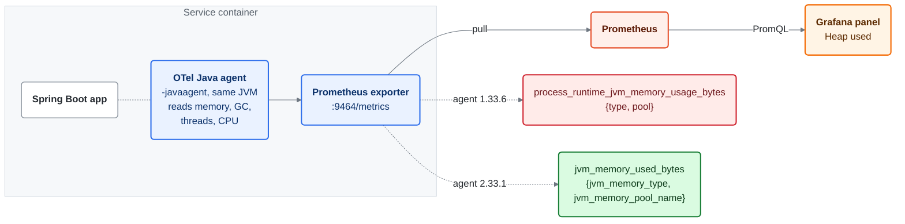

## What changes between agent 1.33.6 and 2.33.1

| Signal | Agent 1.33.6 | Agent 2.33.1 |
|---|---|---|
| Heap / memory used | `process_runtime_jvm_memory_usage_bytes{type, pool}` | `jvm_memory_used_bytes{jvm_memory_type, jvm_memory_pool_name}` |
| Memory limit | `process_runtime_jvm_memory_limit_bytes{type, pool}` | `jvm_memory_limit_bytes{jvm_memory_type, jvm_memory_pool_name}` |
| CPU | `process_runtime_jvm_cpu_utilization_ratio` | `jvm_cpu_recent_utilization` |
| GC | `process_runtime_jvm_gc_duration_seconds{gc, action}` | `jvm_gc_duration_seconds{jvm_gc_name, jvm_gc_action}` |
| Threads | `process_runtime_jvm_threads_count{daemon}` | `jvm_thread_count{jvm_thread_daemon, jvm_thread_state}` |
| Loaded classes | `process_runtime_jvm_classes_current_loaded` | `jvm_class_count` |
| Distinct JVM metric names | 18 | 14 (buffer, init and system CPU metrics are no longer on by default) |
| Agent version label on `target_info` | `telemetry_auto_version` | `telemetry_distro_version` |
| Prometheus exporter listens on | all interfaces | `localhost` only (needs `OTEL_EXPORTER_PROMETHEUS_HOST=0.0.0.0`) |

All captured from the running services: [contract/snapshots/](contract/snapshots/).

**Old → new mapping.** Detection shows which names disappeared and which appeared, but not which replaces which.
The CI gate takes that mapping from OpenTelemetry's official list: the
[Java agent 2.0.0 release notes](https://github.com/open-telemetry/opentelemetry-java-instrumentation/releases/tag/v2.0.0)
("Stable JVM semantic conventions are now emitted") and the
[JVM metrics semantic conventions](https://opentelemetry.io/docs/specs/semconv/runtime/jvm-metrics/).
Name similarity is only a fallback for metrics that list doesn't cover.

## How it detects the change

| When | Check | Catches |
|---|---|---|
| CI, before deploy | [`scripts/check_schema.py`](scripts/check_schema.py) + `mimirtool analyze dashboard` | dashboards or contract using metrics/labels the pinned agent does not emit, with the new name from the official rename list |
| Runtime, with contract | `JvmContractMetricMissing`, `JvmContractLabelMissing`, `JvmUnexpectedMetric` | a contract metric or label with no data; metric names outside the schema snapshot |
| Runtime, no contract | `JvmMetricNameAppeared`, `JvmMetricNameDisappeared`, `JvmMetricCountChanged` | any change in the set of JVM metric names compared with 10 minutes ago |

The contract ([contract/jvm-metrics.yaml](contract/jvm-metrics.yaml)) maps each signal the dashboards
need to the metric and label names that currently carry it. Dashboards and alert rules are generated
from it, so fixing a rename is a change to that one file.

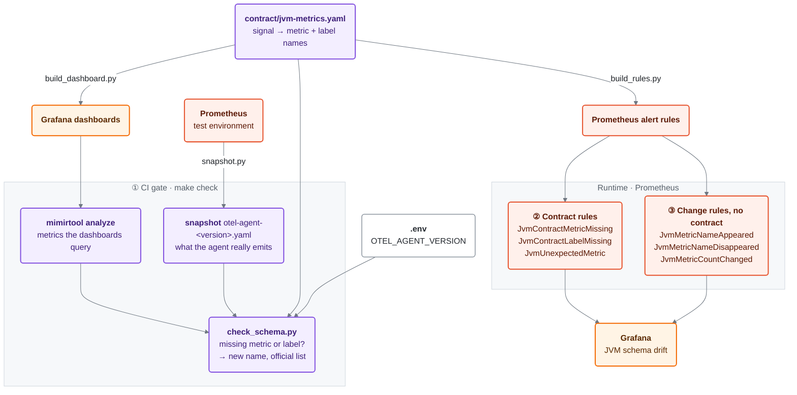

## Demo walkthrough

What happened when the agent was upgraded from 1.33.6 to 2.33.1, step by step.

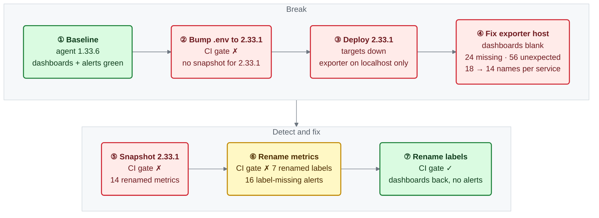

**① Baseline, agent 1.33.6.** JVM dashboard populated, schema-drift dashboard green.

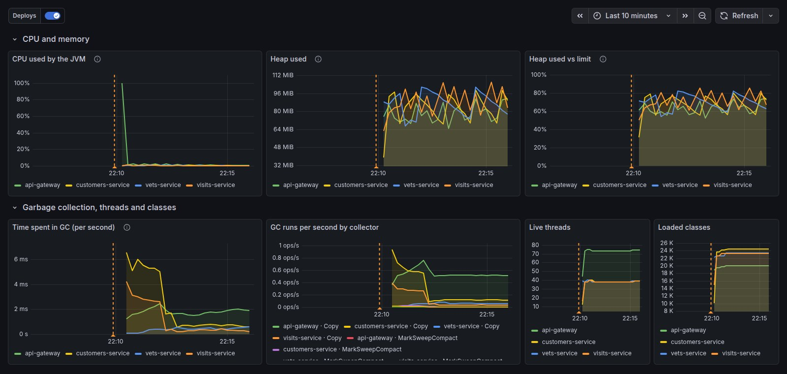
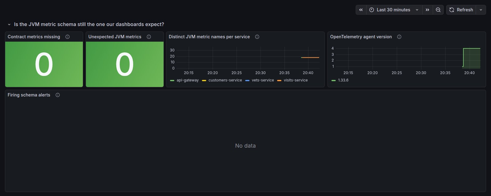

**② Bump `.env` to 2.33.1.** The CI gate refuses: nobody has recorded what 2.33.1 emits yet.

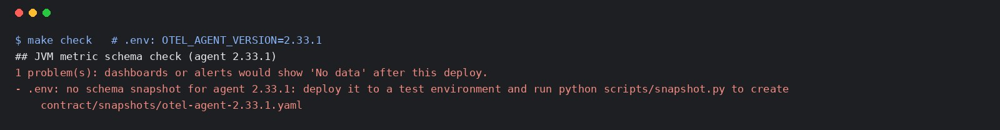

**③–④ Deploy 2.33.1.** First the scrape targets go down (the 2.x exporter listens on `localhost` only). After
`OTEL_EXPORTER_PROMETHEUS_HOST=0.0.0.0`, metrics flow again, but every JVM panel stops at the upgrade, with no error.
The schema alerts fire: 24 contract metrics missing, 56 unexpected metrics, 18 → 14 metric names per service.


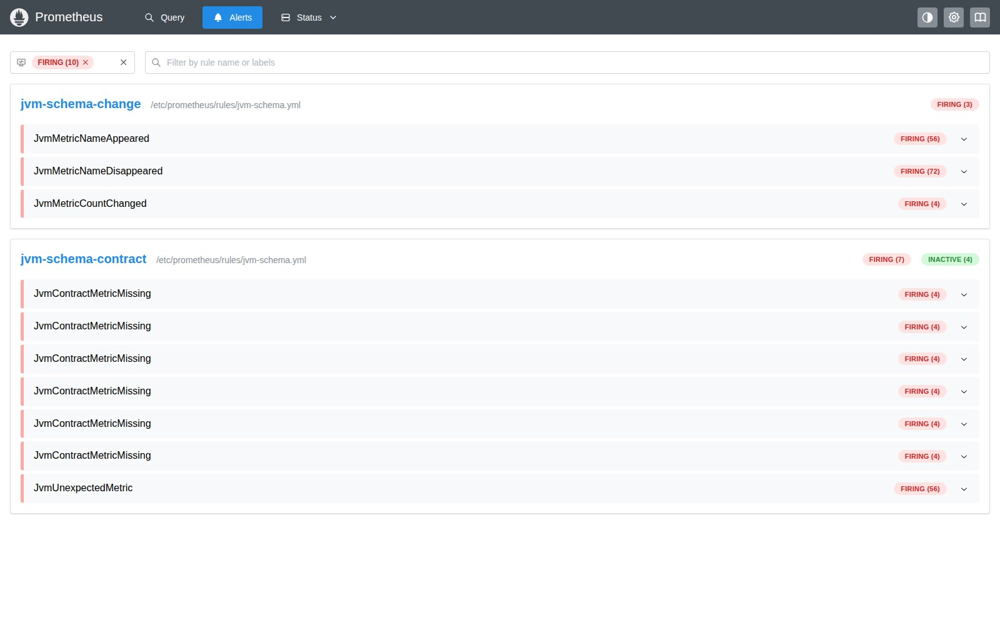

**⑤ Record the 2.33.1 schema (`make snapshot`).** The CI gate now lists every renamed metric and its likely new name.


**⑥ Rename the metrics in the contract only.** Half the dashboard comes back. Heap panels stay empty because they
filter on `type`, which is now `jvm_memory_type`. The gate and the runtime alerts both point at the labels.

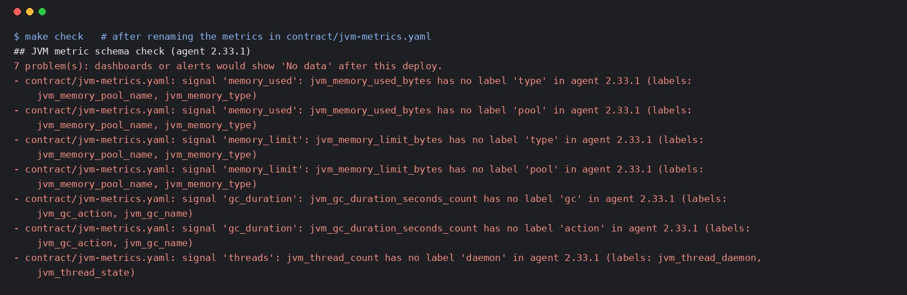
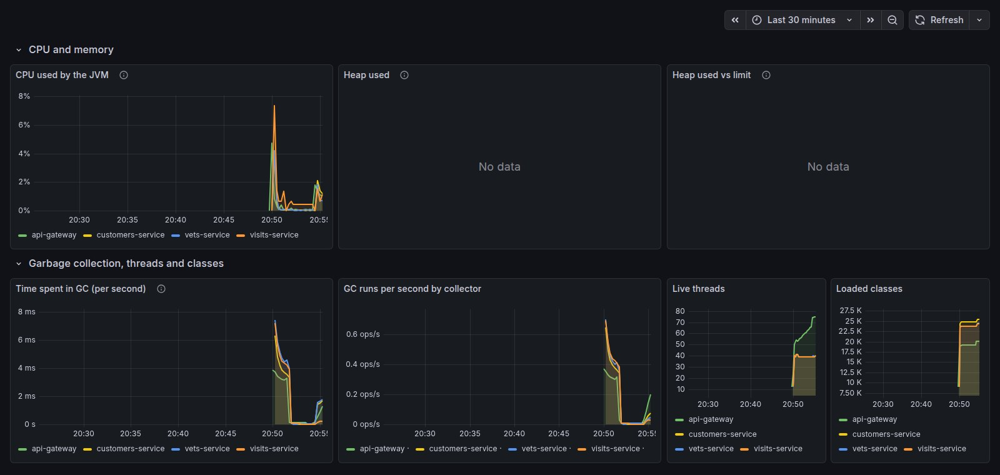
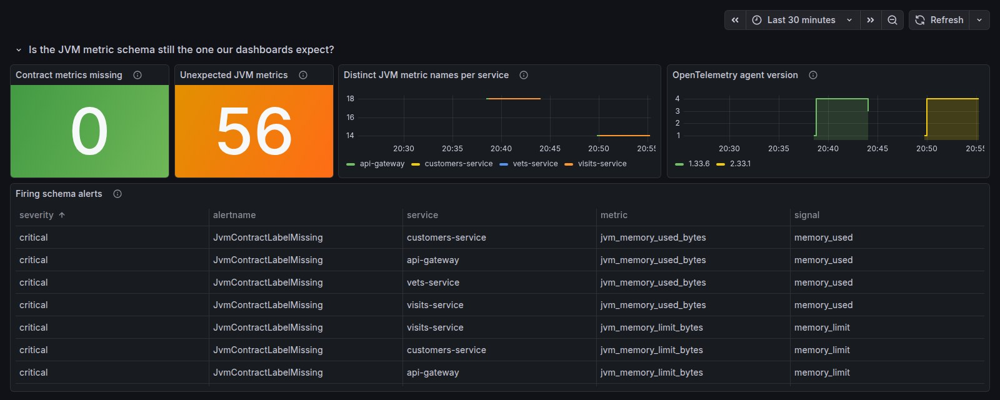

**⑦ Rename the labels too.** Gate green, no schema alerts, dashboards back, including the history since the upgrade.

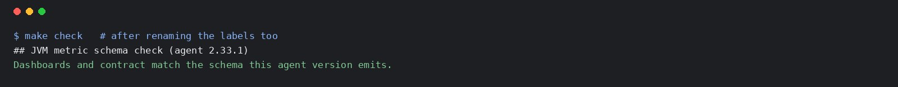
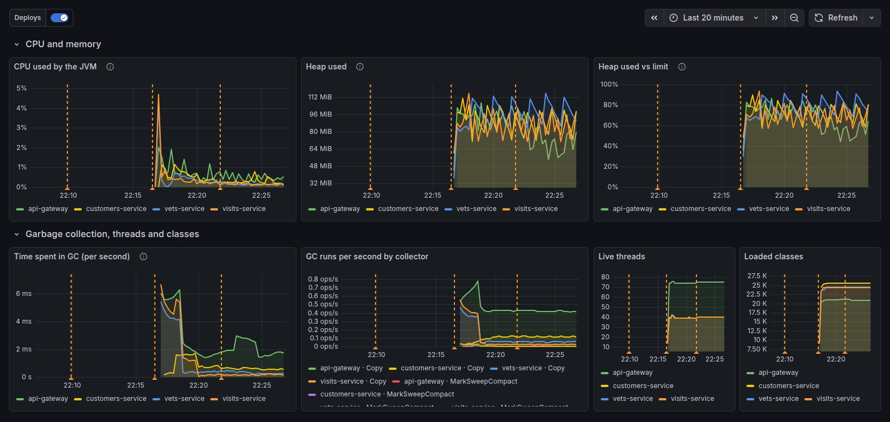
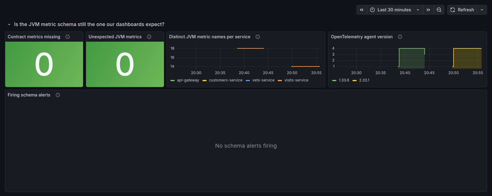

## Fixing it in production

**During the incident:** roll back the agent, or keep it and make queries accept both names (`new_metric or old_metric`).
Then check that alerts on these metrics still evaluate.

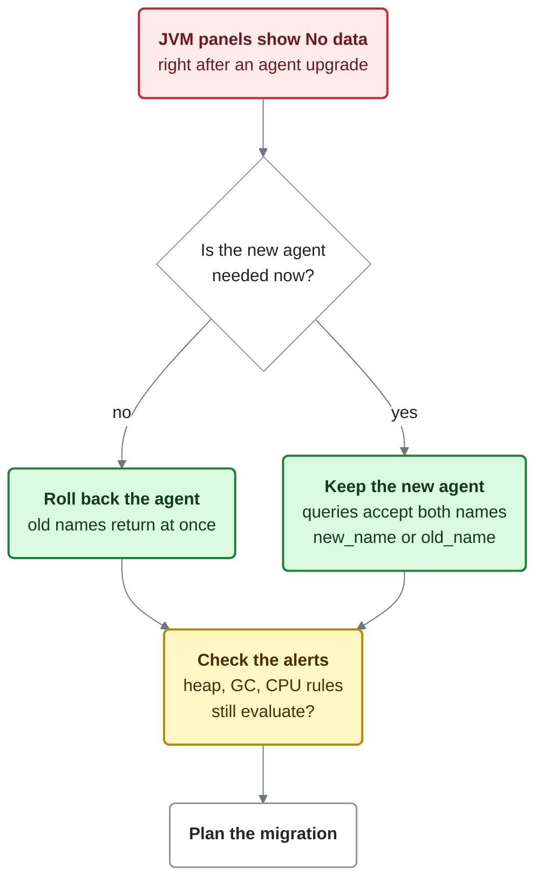

**The migration:** bridge old and new names in the Collector, in Prometheus recording rules, or in the dashboards
(this repo), and roll out with a canary.

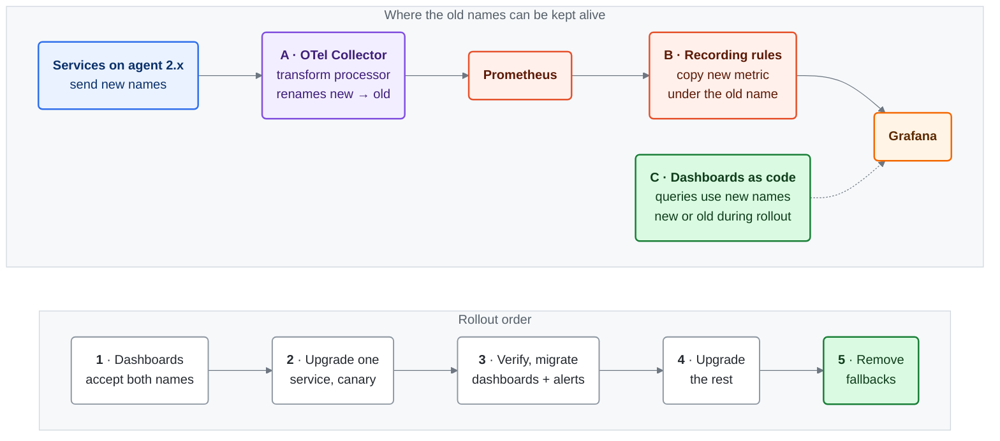

**Prevention:** pinned versions, a CI gate against a staging snapshot, a production canary, and alerts on the
monitoring itself.

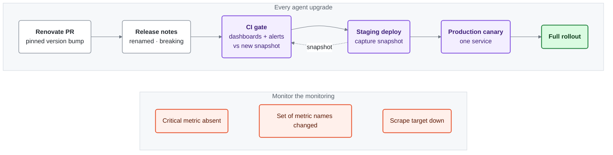

## Run it

Needs Docker and Python 3 with PyYAML. Host ports: app 8180, Prometheus 9190, Grafana 3100.

```bash
make up          # PetClinic + agent from .env, Prometheus, Grafana, k6 traffic,
                 # and a deploy marker (Grafana annotation) with the agent version
```

Grafana: http://localhost:3100 (dashboards *PetClinic · JVM overview* and *PetClinic · JVM schema drift*).

Reproduce the upgrade:

```bash
sed -i 's/^OTEL_AGENT_VERSION=.*/OTEL_AGENT_VERSION=2.33.1/' .env
make check       # fails: no schema snapshot for 2.33.1
make up          # deploy 2.33.1: dashboards go blank, schema alerts fire
make snapshot    # record what 2.33.1 emits
make check       # fails: lists every renamed metric and label
# edit contract/jvm-metrics.yaml, then
make generate && make check && make reload
```

Clean up (removes containers, volumes and metric data):

```bash
make down
```

## Layout

```
.env                          agent version (the one line an upgrade changes)
docker-compose.yml            PetClinic services, agent download, Prometheus, Grafana, k6
contract/jvm-metrics.yaml     signals the dashboards depend on
contract/snapshots/           JVM metric schema per agent version, captured from Prometheus
scripts/                      snapshot, rule and dashboard generators, CI gate
prometheus/rules/             generated alert rules
grafana/dashboards/           generated dashboards
.github/workflows/            CI gate on every push and pull request
```
